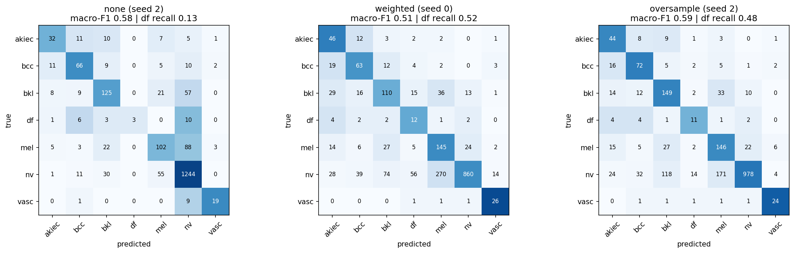

# Projet 2 — Controlled synthetic medical images (DermaMNIST)

Generate synthetic dermoscopy images conditioned on a class, compare a **CVAE** with a **conditional GAN**, and test whether the synthetic images help a classifier on the **rare class** (dermatofibroma), without copying the training images.

The full plan, with a mind map and progress checkboxes, is in [`impl.md`](impl.md).

**New team member? Start with [`docs/GUIDE.md`](docs/GUIDE.md):** step-by-step setup, how to run each notebook, and the role of every file.

## Status

| Step | Content | Status |
|---|---|---|
| S0 | Setup, repository structure | done |
| S1 | Data: DermaMNIST 64 × 64, class statistics | done |
| S2 | Baseline classifier (real data only) | done |
| S3 | Generative models: CVAE (15 epochs, β = 0.5 / 1 / 2) and conditional GAN (100 epochs) | done |
| S4 | Synthetic sets: 800 images per class per model, fixed seed, leak check, SYNTHETIC watermark | done |
| S5–S7 | Evaluation, demo, report | to do |

## Installation

**Locally (Windows, existing `.venv`):**
```powershell
.\.venv\Scripts\Activate.ps1
pip install -r mini_project\requirements.txt
```

**Google Colab:** open a notebook and run its first cell. It clones this repository and installs `requirements.txt` automatically. Choose a GPU runtime for training.

## Run

```bash
python data/download.py          # DermaMNIST 64x64 into data/ (~100 MB, not committed)
```
Then run the notebooks in order:

| Notebook | Step | Outputs in `results/` |
|---|---|---|
| `notebooks/01_data.ipynb` | S1 data exploration | class distribution, example images |
| `notebooks/02_baseline.ipynb` | S2 baseline classifier (Colab GPU) | precision / recall / F1 tables, confusion matrices |
| `notebooks/03a_cvae.ipynb` | S3a conditional VAE (Colab GPU) | samples, β experiment, diversity, interpolation |
| `notebooks/03b_cgan.ipynb` | S3b conditional GAN (Colab GPU) | samples, losses, diversity, interpolation |
| `notebooks/04_generate.ipynb` | S4 synthetic sets (laptop CPU) | set sizes, real vs CVAE vs cGAN, watermarked examples |

Hyper-parameters are in `configs/`.

## Repository layout

```
configs/     experiment parameters (YAML)
data/        download script + data card (no data committed)
notebooks/   numbered notebooks
src/         reusable code (data, models, training, plots)
results/     figures and tables
demo/        demo app + video (S6)
report/      final report (S7)
docs/        licences, model card, ethics (S7)
```

## Data

DermaMNIST (MedMNIST v3, from HAM10000), licence **CC BY-NC 4.0**. See [`data/DATA_CARD.md`](data/DATA_CARD.md).

## Running on Colab from VS Code

With the VS Code Colab extension, the code runs on Google's machine, so result files stay there. The last cell of each training notebook prints the results as text; save the notebook (Ctrl+S), then extract them locally:

```powershell
..\.venv\Scripts\python.exe -m src.extract_results notebooks\02_baseline.ipynb
```

## Main results

### S2 — Baseline classifier (real data only, test set, mean ± std over 3 seeds)

| strategy | macro precision | macro recall | macro F1 | df precision | df recall | df F1 |
|---|---|---|---|---|---|---|
| none (R0) | 0.702 ± 0.022 | 0.565 ± 0.009 | 0.587 ± 0.006 | 0.889 ± 0.157 | 0.116 ± 0.020 | 0.205 ± 0.036 |
| weighted | 0.462 ± 0.006 | 0.644 ± 0.004 | 0.507 ± 0.003 | 0.122 ± 0.007 | 0.522 ± 0.000 | 0.198 ± 0.009 |
| oversample (R1) | 0.551 ± 0.017 | 0.694 ± 0.013 | 0.603 ± 0.014 | 0.394 ± 0.044 | 0.565 ± 0.071 | 0.464 ± 0.051 |

Trained on real data only, the classifier finds only about 12 % of the dermatofibroma images (df). Oversampling helps most but only repeats the same 80 images: synthetic images will have to beat it.


