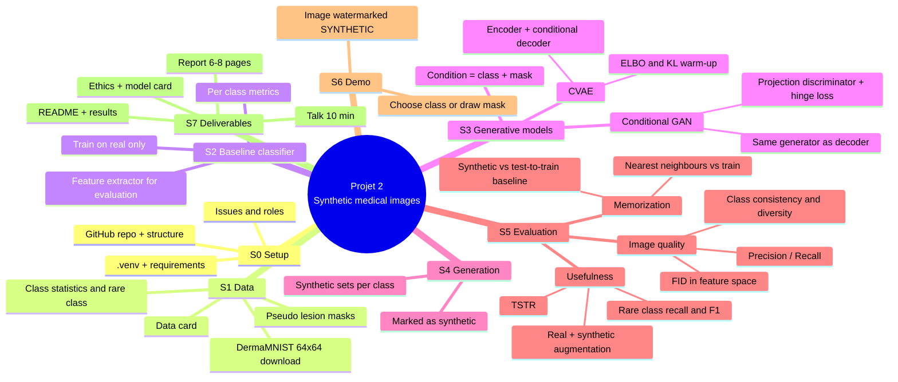

# Implementation plan: Projet 2, controlled synthetic medical images

> **Goal in one sentence:** generate synthetic dermoscopy images conditioned on a **class** (and optionally a **lesion mask**), compare a **CVAE** with a **conditional GAN**, check whether the synthetic images help a classifier on the **rare class**, and verify the generators **do not copy** training images.

Tick a box (`- [ ]` → `- [x]`) as soon as a task is finished.

---

## 0. Key decisions

| Decision | Choice | Why |
|---|---|---|
| Modality | **Dermoscopy, DermaMNIST** (MedMNIST+) | 7 classes with strong imbalance, so there is a real rare class to help. PneumoniaMNIST has only 2 classes and no truly rare class. |
| Resolution | **64 × 64 RGB** (move to 128 × 128 only if time allows) | Fits easily in 12 GB VRAM and trains fast on Colab/Kaggle. |
| Split | **Official train / val / test** (7 007 / 1 003 / 2 005) | Required by the brief. 7 007 train images is already within the 5 000–10 000 range. |
| Rare class | **Dermatofibroma, class 3** (~80 train images). Secondary: **vascular lesions, class 6** (~99) | Smallest classes, so this is where augmentation can matter. |
| Lesion "zone" | **Pseudo-masks** from Otsu thresholding plus the largest central component | DermaMNIST has no masks, so we build them automatically. They enable "draw a mask, then generate". |
| Fair comparison | **Same decoder/generator architecture** for the CVAE and the cGAN | Only the training objective differs (ELBO vs adversarial). |
| Compute | Local CPU `.venv` for code and debugging; **Colab/Kaggle GPU (≤ 12 GB)** for full training | Required by the brief. |

DermaMNIST classes: `0 akiec · 1 bcc · 2 bkl · 3 df (rare) · 4 mel · 5 nv (majority, ~67%) · 6 vasc`

---

## 1. Mind map of the project



Plain-text version, in case Mermaid does not render:

```
Projet 2
├── S0 Setup ............ .venv, repo, issues
├── S1 Data ............. DermaMNIST 64px, stats, pseudo-masks, data card
├── S2 Baseline ......... CNN on real data → per-class metrics + feature extractor
├── S3 Models ........... CVAE  vs  cGAN  (condition = class + mask)
├── S4 Generation ....... synthetic sets per class, labelled "synthetic"
├── S5 Evaluation ....... quality (FID, P/R) · memorization (NN) · usefulness (augment, TSTR)
├── S6 Demo ............. Gradio: class/mask → watermarked image
└── S7 Deliverables ..... README, report, talk, docs/ethics
```

---

## 2. Target repository layout (required by the brief)

```
mini_project/
├── README.md            # overview, install, run commands, main results
├── impl.md              # this plan
├── requirements.txt
├── .gitignore           # data/raw, *.pt, *.npz, outputs/ heavy files
├── notebooks/
│   ├── 01_data.ipynb
│   ├── 02_baseline.ipynb
│   ├── 03a_cvae.ipynb
│   ├── 03b_cgan.ipynb
│   ├── 04_evaluation.ipynb      # quality + memorization + augmentation + TSTR
│   └── 05_demo.ipynb
├── src/
│   ├── data.py          # loading, normalisation, balanced sampler
│   ├── masks.py         # Otsu pseudo-masks, mask bank + augmentation
│   ├── models.py        # CVAE, Generator, Discriminator, Classifier
│   ├── train_gen.py     # CVAE / cGAN training loops
│   ├── train_clf.py     # classifier training + evaluation
│   ├── metrics.py       # FID, precision/recall, NN distances
│   └── utils.py         # seeds, grids, watermark
├── configs/
│   ├── cvae.yaml
│   ├── cgan.yaml
│   └── classifier.yaml
├── data/
│   ├── download.py      # downloads DermaMNIST (no data committed)
│   └── DATA_CARD.md
├── results/             # figures, tables, sample grids (small files only)
├── demo/
│   ├── app.py           # Gradio app
│   └── demo.mp4         # short video
├── report/              # final report (PDF + sources)
└── docs/
    ├── LICENSES.md      # MedMNIST CC BY 4.0, HAM10000 source
    ├── MODEL_CARD.md
    └── ETHICS.md
```

Large files (datasets, `.pt` checkpoints, `.npz` synthetic sets) stay **out of Git**. Store them on Google Drive or Kaggle Datasets and link them from the README.

---

## 3. Steps, explained, with checkboxes

### S0: Environment and repository setup

**What and why:** a reproducible environment and an organized repo. The brief says the repo is the project's log book.

Use the existing `.venv` (Windows, from `genia_visual/`):

```powershell
.\.venv\Scripts\Activate.ps1
pip install medmnist torch torchvision numpy scipy scikit-learn matplotlib pandas tqdm pyyaml gradio
pip freeze > mini_project\requirements.txt
```

On Colab/Kaggle: `!pip install -r requirements.txt` after cloning the repo.

- [ ] Activate `.venv` and install the dependencies
- [ ] Create `requirements.txt`
- [ ] `git init`, create the GitHub repo, add the folder structure above and a `.gitignore`
- [ ] Create GitHub **issues** for every step (S1…S7) and assign members
- [ ] Agree on a commit convention (for example `feat(cvae): add KL warm-up`)
- [ ] Check that a GPU notebook runs on Colab/Kaggle (`torch.cuda.is_available()`)

---

### S1: Data (notebook `01_data`)

**What and why:** understand the dataset, identify the rare class, and build the lesion masks used as a spatial condition.

1. **Download** with `medmnist.DermaMNIST(split=..., size=64, download=True)`.
2. **Statistics:** count images per class and per split, and plot a bar chart. The imbalance (nv ≈ 67%, df ≈ 1%) motivates the whole project.
3. **Pseudo-masks:** convert to grayscale, apply a Gaussian blur, then an Otsu threshold (the lesion is darker than the skin). Apply morphological opening and fill holes. Keep the connected component that is **large and close to the centre** (this avoids dark vignetted corners). If the mask covers < 2% or > 90% of the image, fall back to a centred ellipse.
4. **Mask bank:** store the masks per class. At generation time, sample a mask of the requested class and apply random flips, 90° rotations and small scaling, so the generators also get unseen shapes.
5. **Normalisation:** pixels in `[-1, 1]`. Same-flip augmentation for image and mask.

- [ ] Download script `data/download.py`
- [ ] Class distribution table + bar chart → `results/`
- [ ] Sample grid: 8 images per class
- [ ] Pseudo-mask function + visual check (overlays) on ~50 images
- [ ] Save masks (`.npz`, not committed)
- [ ] Write `data/DATA_CARD.md` (source HAM10000, licence, split, biases: mostly light skin, single-centre style)

---

### S2: Baseline classifier (notebook `02_baseline`)

**What and why:** the reference point. It answers "how well do we do on the rare class with **real data only**?". The same network also serves as the **feature extractor** for FID and memorization, because its features are domain-specific.

- Model: small CNN (4 conv blocks 32→64→128→256, BatchNorm, GAP, dropout, 7 outputs), or ResNet-18 if the GPU allows.
- Training: Adam 1e-3, about 20 epochs, horizontal and vertical flips. Select the model on **val balanced accuracy**.
- Metrics (test): accuracy, **balanced accuracy**, **macro-F1**, and for the **rare class** recall, precision, F1 and one-vs-rest AUC. Include a confusion matrix.
- Run **3 seeds** and report mean ± std. Single runs are noisy on a class with ~23 test images.

- [ ] Implement `Classifier` + training loop
- [ ] Train the baseline (3 seeds) and save the best checkpoint
- [ ] Per-class report + confusion matrix → `results/`
- [ ] Two extra baselines for a fair comparison: **oversampling** of the rare class and **class-weighted loss**

---

### S3: Generative models (notebooks `03a_cvae`, `03b_cgan`)

**Shared conditional generator/decoder:** `z (64) + class embedding (32)` → FC → 256×4×4 → 4 upsampling blocks (4→8→16→32→64). At **every resolution the resized mask is concatenated** as an extra channel, and a final conv with tanh outputs 3 channels. The class controls *what* the lesion is; the mask controls *where/what shape* it is.

**Sampling during training:** sqrt-inverse-frequency sampler, so the rare classes are seen more often without being fully repeated. A full repeat would raise the memorization risk.

#### S3a: CVAE

- Encoder input: image + mask + one-hot class maps (3+1+7 channels) → convs → `μ, log σ²`.
- Loss = reconstruction (MSE/L1) + β·KL, with **KL warm-up** (β from 0 to 1 over ~10 epochs) to avoid posterior collapse.
- Expected behaviour: stable and diverse, but **blurry**. This is the classic trade-off to discuss.

- [ ] Implement encoder + reparameterisation + decoder
- [ ] Train (~40–60 epochs on GPU), log the losses (recon, KL)
- [ ] Save sample grids per class every N epochs
- [ ] Test interpolation in `z` (same class/mask) and swapping the class with a fixed mask

#### S3b: Conditional GAN

- Generator: **same architecture** as the CVAE decoder.
- Discriminator: image + mask as input, spectral norm, **projection** conditioning on the class (`out = ψ(h) + ⟨embed(y), h⟩`).
- Loss: **hinge**, Adam (2e-4, β=(0.0, 0.9)), **EMA** of generator weights for sampling. Optionally use DiffAugment, which helps on small datasets and rare classes.
- Expected behaviour: sharper images, but a risk of **mode collapse** and of **memorizing** the ~80 df images.

- [ ] Implement G, D, hinge loss, EMA
- [ ] Train (~60–100 epochs), log D/G losses, save checkpoints
- [ ] Sample grids per class, check for mode collapse visually
- [ ] Check that changing the mask moves or reshapes the lesion

- [ ] Keep all hyper-parameters in `configs/*.yaml`
- [ ] Upload checkpoints to Drive/Kaggle (not Git)

---

### S4: Generation of synthetic sets

**What and why:** build fixed, reproducible synthetic datasets for the experiments.

- For each model and each class, generate N images (for example 600 per class), with masks taken from the augmented mask bank.
- Store the images, labels, masks and a flag `synthetic=True`. Every image saved for viewing gets a **"SYNTHETIC" watermark**. The training arrays stay clean but live in a separate file.
- **Rule from the brief:** synthetic images are added **only to the training set**. Validation and test stay 100% real.

- [ ] Generation script with a fixed seed
- [ ] `results/`: side-by-side grid of real, CVAE and cGAN images per class
- [ ] Verify that no synthetic file is ever loaded in val/test code

---

### S5: Evaluation (notebook `04_evaluation`)

#### S5a: Image quality

| Metric | What it measures |
|---|---|
| **FID** (features of the S2 classifier; optional Inception-FID on GPU) | Distance between the real and synthetic distributions. Sample synthetic labels with the real class proportions so the comparison is fair. |
| **Precision / Recall** (k-NN in feature space) | Precision measures realism; recall measures coverage of the real diversity. |
| **Class consistency** | Accuracy of the baseline classifier on synthetic images. Does a generated "df" look like a df? |
| **Diversity ratio** per class | Mean pairwise feature distance, synthetic / real. A value well below 1 means mode collapse. |

- [ ] Compute the metrics for the CVAE and the cGAN plus a real-val vs real-train reference
- [ ] Table + visual examples → `results/`

#### S5b: Memorization check ("does not copy training images")

- For each synthetic image, find its **nearest neighbour in the training set** (pixel L2 and cosine distance in feature space).
- Compare with the **reference distribution of real test → train distances**. HAM10000 has several images per lesion, so real pairs can already be close.
- Report the median NN distance and the **% of synthetic images closer than the 5th percentile** of test→train distances ("suspected copies"), **per class**. The rare class is the most at risk.
- Show the 8 closest synthetic/train pairs per model.

- [ ] NN search (pixel + feature)
- [ ] Histograms: synthetic→train vs test→train
- [ ] "Closest pairs" figure + suspected-copy rate per class
- [ ] Discussion: does the cGAN copy more than the CVAE on df?

#### S5c: Usefulness for the classifier (core question)

Same classifier, same epochs, **3 seeds**, test on **real** test only:

| Run | Training data |
|---|---|
| R0 | real (baseline) |
| R1 | real + oversampled rare class (control) |
| R2 | real + CVAE synthetic (rare class) |
| R3 | real + cGAN synthetic (rare class) |
| (opt.) | sweep over the amount of synthetic data: +100 / +200 / +400 / +800 |

Main metrics: **rare-class recall and F1**, macro-F1, balanced accuracy. Also check that the other classes do not degrade.

- [ ] Run R0–R3 × 3 seeds, save JSON results
- [ ] Table mean ± std + bar chart of rare-class F1
- [ ] Optional sweep over the number of synthetic images

#### S5d: TSTR (Train on Synthetic, Test on Real)

- Train the classifier **only on synthetic data** (all 7 classes, balanced) and test it on real test. Compare with **TRTR** (train real, test real = R0).
- A small TSTR–TRTR gap means the synthetic images carry the real class information.

- [ ] TSTR for the CVAE and the cGAN
- [ ] Table TSTR vs TRTR

---

### S6: Interactive demo (`demo/app.py`, notebook `05_demo`)

**What and why:** the "Démo finale" from the brief. The user picks a **class**, chooses a **model** (CVAE/cGAN), and either **draws a lesion mask** (Gradio Sketchpad) or picks a random mask. The app returns the image upscaled and clearly marked **"SYNTHETIC / SYNTHÉTIQUE"**.

- [ ] Gradio interface: class dropdown, model radio, sketchpad, seed slider
- [ ] Watermark on every output
- [ ] Runs locally in `.venv` (CPU is enough for inference) and on Colab (`share=True`)
- [ ] Record a short video `demo/demo.mp4`

---

### S7: Deliverables

- [ ] **README.md**: presentation, installation (`.venv` / Colab), run commands, main results table, examples
- [ ] **docs/MODEL_CARD.md**: intended use (research/education only, **not for diagnosis**), training data, metrics, limits
- [ ] **docs/ETHICS.md**: synthetic images must never be presented as real patients; privacy and memorization; dataset bias (skin tones); watermarking
- [ ] **docs/LICENSES.md**: MedMNIST (CC BY 4.0), HAM10000, libraries
- [ ] **Report (6–8 pages)**: introduction, data, methods (CVAE vs cGAN, masks), evaluation protocol, results (quality, memorization, augmentation, TSTR), discussion and limits, conclusion
- [ ] **Talk (10 min)**: ~8 slides + live demo
- [ ] Weekly commits from every member, issues closed

---

## 4. Suggested weekly schedule

| Week | Work | Steps |
|---|---|---|
| 1 | Setup, data, masks, data card | S0, S1 |
| 2 | Baseline classifier + feature extractor | S2 |
| 3 | CVAE | S3a |
| 4 | Conditional GAN | S3b |
| 5 | Generation, quality, memorization | S4, S5a, S5b |
| 6 | Augmentation experiments + TSTR | S5c, S5d |
| 7 | Demo, docs, README | S6, S7 |
| 8 | Report + talk rehearsal | S7 |

---

## 5. Risks and mitigations

| Risk | Mitigation |
|---|---|
| Only ~80 df images: the GAN memorizes or collapses | Sqrt sampler, DiffAugment, EMA, memorization check per class, early stopping on the copy rate |
| Pseudo-masks are wrong on some images | Ellipse fallback, visual check, and the mask is only a soft condition |
| Noisy results on the rare class (~23 test images) | 3 seeds, mean ± std, macro-F1 and balanced accuracy in addition to recall |
| GPU time limits (Colab) | 64×64 first, checkpoints on Drive, resumable training |
| Synthetic data leaking into evaluation | Separate files, assertion in the data-loading code |
