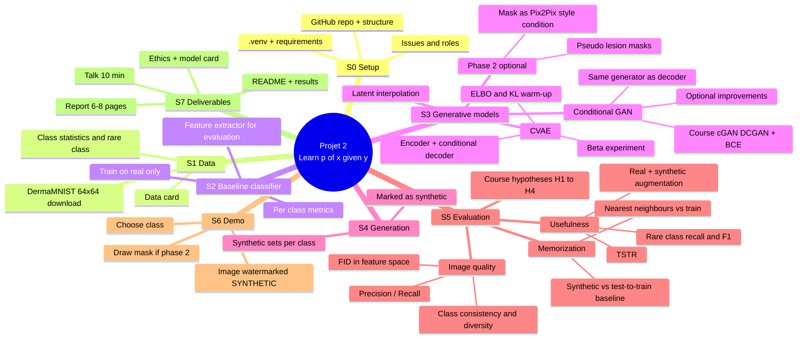

# Implementation plan: Projet 2, controlled synthetic medical images

> **Goal in one sentence:** learn **p(x | y)**, the distribution of dermoscopy images x given a condition y (the **class**, and optionally a **lesion mask**). We compare a **CVAE** with a **conditional GAN**, check whether the synthetic images help a classifier on the **rare class**, and verify the generators **do not copy** training images.

Tick a box (`- [ ]` → `- [x]`) as soon as a task is finished.

---

## 0. Key decisions

| Decision | Choice | Why |
|---|---|---|
| Modality | **Dermoscopy, DermaMNIST** (MedMNIST+) | 7 classes with strong imbalance, so there is a real rare class to help. PneumoniaMNIST has only 2 classes and no truly rare class. |
| Resolution | **64 × 64 RGB** (128 × 128 only if time allows) | Fits easily in 12 GB VRAM and trains fast on Colab/Kaggle. |
| Split | **Official train / val / test** (7 007 / 1 003 / 2 005) | Required by the brief. 7 007 train images is already within the 5 000–10 000 range. |
| Rare class | **Dermatofibroma, class 3** (~80 train images). Secondary: **vascular lesions, class 6** (~99) | Smallest classes, so this is where augmentation can matter. |
| Condition y | **Phase 1: class only.** Phase 2 (optional): class + **lesion mask** | The brief says "choisir une classe **ou** dessiner un masque", so the class alone satisfies it. The mask pipeline is the riskiest part, so it comes second. |
| CVAE | Course CVAE: encoder q(z \| x, y), decoder p(x \| z, y), ELBO = reconstruction + β·KL | AE/VAE course, slides 11–21. |
| Conditional GAN | **Course cGAN** (Mirza & Osindero): class embedding concatenated in G and D, BCE loss, non-saturating G loss, DCGAN architecture | GAN course, slides 10, 18–20, 22–24. Every choice can be justified from the course in the talk. |
| Fair comparison | **Same decoder/generator architecture** for the CVAE and the cGAN | Only the training objective differs (ELBO vs adversarial). |
| Compute | Local CPU `.venv` for code and debugging; **Colab/Kaggle GPU (≤ 12 GB)** for full training | Required by the brief. |

DermaMNIST classes: `0 akiec · 1 bcc · 2 bkl · 3 df (rare) · 4 mel · 5 nv (majority, ~67%) · 6 vasc`

### Hypotheses from the course (to confirm or refute in the report)

| # | Hypothesis | Source | How we test it |
|---|---|---|---|
| H1 | The CVAE gives **blurrier** images than the cGAN (the decoder predicts the average of several possible images) | AE/VAE course, slide 19; GAN course, slide 37 | FID, visual grids, sharpness |
| H2 | The CVAE is **more diverse and more stable**; the cGAN risks **mode collapse** | GAN course, slides 15–16 and 37 | Diversity ratio, recall, loss curves |
| H3 | With very few images (df ≈ 80), the cGAN is **more likely to memorize** | Intro course: extreme overfitting = "échantillonner les données d'entraînement" | Nearest-neighbour check per class |
| H4 | Synthetic images can **improve the rare class** ("compléter des données rares, imagerie médicale") | GAN course, slides 3 and 38 | Augmentation experiments R0–R3, TSTR |

---

## 1. Mind map of the project



Plain-text version, in case Mermaid does not render:

```
Projet 2: learn p(x | y)
├── S0 Setup ............ .venv, repo, issues
├── S1 Data ............. DermaMNIST 64px, stats, data card
├── S2 Baseline ......... CNN on real data → per-class metrics + feature extractor
├── S3 Models ........... CVAE (+ β experiment)  vs  course cGAN (DCGAN + BCE)
│                         interpolation · phase 2 (optional): lesion mask condition
├── S4 Generation ....... synthetic sets per class, labelled "synthetic"
├── S5 Evaluation ....... quality (FID, P/R) · memorization (NN) · usefulness (augment, TSTR)
│                         → confirm or refute hypotheses H1–H4
├── S6 Demo ............. Gradio: class (+ mask) → watermarked image
└── S7 Deliverables ..... README, report, talk, docs/ethics
```

---

## 2. Target repository layout (required by the brief)

```
mini_project/
├── README.md            # overview, install, run commands, main results
├── impl.md              # this plan
├── requirements.txt
├── .gitignore           # data, *.pt, *.npz, heavy outputs
├── notebooks/
│   ├── 01_data.ipynb
│   ├── 02_baseline.ipynb
│   ├── 03a_cvae.ipynb
│   ├── 03b_cgan.ipynb
│   ├── 03c_masks.ipynb          # phase 2 only
│   ├── 04_evaluation.ipynb      # quality + memorization + augmentation + TSTR
│   └── 05_demo.ipynb
├── src/
│   ├── data.py          # loading, normalisation, balanced sampler
│   ├── masks.py         # phase 2: Otsu pseudo-masks, mask bank + augmentation
│   ├── models.py        # CVAE, Generator, Discriminator, Classifier
│   ├── train_gen.py     # CVAE / cGAN training loops
│   ├── train_clf.py     # classifier training + evaluation
│   ├── metrics.py       # FID, precision/recall, NN distances
│   └── utils.py         # seeds, grids, interpolation (lerp/slerp), watermark
├── configs/
│   ├── cvae.yaml
│   ├── cgan.yaml
│   └── classifier.yaml
├── data/
│   ├── download.py      # downloads DermaMNIST (no data committed)
│   └── DATA_CARD.md
├── results/             # figures, tables, sample grids (small files only)
├── demo/
│   ├── app.py           # Gradio app
│   └── demo.mp4         # short video
├── report/              # final report (PDF + sources)
└── docs/
    ├── LICENSES.md      # MedMNIST CC BY 4.0, HAM10000 source
    ├── MODEL_CARD.md
    └── ETHICS.md
```

Large files (datasets, `.pt` checkpoints, `.npz` synthetic sets) stay **out of Git**. Store them on Google Drive or Kaggle Datasets and link them from the README.

---

## 3. Steps, explained, with checkboxes

### S0: Environment and repository setup

**What and why:** a reproducible environment and an organized repo. The brief says the repo is the project's log book.

Use the existing `.venv` (Windows, from `genia_visual/`):

```powershell
.\.venv\Scripts\Activate.ps1
pip install medmnist torch torchvision numpy scipy scikit-learn matplotlib pandas tqdm pyyaml gradio
pip freeze > mini_project\requirements.txt
```

On Colab/Kaggle: `!pip install -r requirements.txt` after cloning the repo.

- [x] Activate `.venv` and install the dependencies
- [x] Create `requirements.txt`
- [x] `git init`, create the GitHub repo and a `.gitignore`
- [x] Add the folder structure above
- [ ] Create GitHub **issues** for every step (S1…S7) and assign members
- [ ] Agree on a commit convention (for example `feat(cvae): add KL warm-up`)
- [x] Check that a GPU notebook runs on Colab (`torch.cuda.is_available()`)

---

### S1: Data (notebook `01_data`)

**What and why:** understand the dataset and identify the rare class.

1. **Download** with `medmnist.DermaMNIST(split=..., size=64, download=True)`.
2. **Statistics:** count images per class and per split, and plot a bar chart. The imbalance (nv ≈ 67%, df ≈ 1%) motivates the whole project.
3. **Normalisation:** pixels in `[-1, 1]` to match the `tanh` output of the generators (GAN course, slide 18).

- [x] Download script `data/download.py`
- [x] Class distribution table + bar chart → `results/`
- [x] Sample grid: 8 images per class (+ mean image per class)
- [x] Write `data/DATA_CARD.md` (source HAM10000, licence CC BY-NC 4.0, split, biases)

---

### S2: Baseline classifier (notebook `02_baseline`)

**What and why:** the reference point. It answers "how well do we do on the rare class with **real data only**?". The same network also serves as the **feature extractor** for FID and memorization. The GAN course (slide 39) warns that Inception features (trained on ImageNet) are poorly suited to medical images, so domain-specific features are a better choice.

- Model: small CNN (4 conv blocks 32→64→128→256, BatchNorm, GAP, dropout, 7 outputs), or ResNet-18 if the GPU allows.
- Training: Adam 1e-3, about 20 epochs, horizontal and vertical flips. Select the best epoch on **validation macro-F1**.
- Metrics (test): **precision, recall and F1**, per class and macro-averaged, with a focus on the **rare class df**, plus the **confusion matrix**.
- Run **3 seeds** and report mean ± std. Single runs are noisy on a class with ~23 test images.
- Code: `src/models.py`, `src/train_clf.py`, `configs/classifier.yaml`, notebook `02_baseline.ipynb`.

- [x] Implement `Classifier` + training loop
- [x] Two extra baselines for a fair comparison: **oversampling** of the rare class and **class-weighted loss**
- [x] Train the baseline (3 strategies × 3 seeds) on a Colab GPU and save the best checkpoint
- [x] Per-class precision / recall / F1 + confusion matrices → `results/`
- [x] Write the interpretation in the notebook

**Result (test, mean over 3 seeds):** `none` macro-F1 0.587, df recall 0.116, df F1 0.205 · `weighted` macro-F1 0.507, df F1 0.198 · `oversample` macro-F1 0.603, df recall 0.565, df F1 0.464. Synthetic images must beat **oversampling** (R1), not only the plain baseline (R0).

---

### S3: Generative models (notebooks `03a_cvae`, `03b_cgan`)

**Shared conditional generator/decoder:** `z (64) + class embedding (32)` → FC → 256×4×4 → 4 upsampling blocks (4→8→16→32→64, BatchNorm + ReLU) → final conv + `tanh` → 3×64×64. This is the DCGAN generator from the GAN course (slides 19–20), with the class embedding concatenated to z (cGAN, slide 23). The class controls *what* lesion is generated.

**Sampling during training:** sqrt-inverse-frequency sampler, so the rare classes are seen more often without being fully repeated. A full repeat would raise the memorization risk.

**Code:** `src/models.py` (`CondGenerator`, `CVAE`, `CondDiscriminator`), `src/train_gen.py` (training loops, diversity), `configs/cvae.yaml`, `configs/cgan.yaml`, notebooks `03a_cvae.ipynb` and `03b_cgan.ipynb`. Both notebooks end with an export cell; locally run `python -m src.extract_results notebooks/<notebook>.ipynb`.

- [x] Write the S3 code and notebooks (checked locally with 1 epoch on a small subset)

#### S3a: CVAE

- Encoder q(z | x, y): image + one-hot class maps (3+7 channels) → strided convs → `μ, log σ²` (two heads, as in the course).
- Reparameterisation: `z = μ + σ ⊙ ε`, ε ~ N(0, I) (AE/VAE course, slide 15).
- Loss = reconstruction (MSE) + β·KL, with **KL warm-up** (β from 0 to its target over ~10 epochs) to avoid posterior collapse.
- Generation: choose y, draw z ~ N(0, I), decode [z, y] (slide 21).
- **β experiment** (β-VAE, slide 20): train with β = 0.5, 1 and 2. Expect sharper images with β < 1 and a smoother latent space but blurrier images with β > 1.
- Expected behaviour: stable and diverse, but **blurry** (hypothesis H1).

- [ ] Implement encoder + reparameterisation + decoder
- [x] Train 15 epochs on a Colab GPU (`QUICK = True`: 10 epochs, β = 1 only), log the losses (reconstruction, KL)
- [x] Add a clamp on log σ² (KL reached ~7·10⁹ at epoch 1 in the first run, recovered at epoch 2)

**Result (15 epochs):** final KL 64.9 / 41.7 / 29.1 and val MSE 0.0119 / 0.0123 / 0.0131 for β = 0.5 / 1 / 2 (the β-VAE trade-off of the course). Images blurry (H1); class effect visible but weak.
- [ ] Save sample grids per class every N epochs
- [ ] β experiment: β = 0.5 / 1 / 2, same epochs, compare grids and FID
- [ ] Swap the class with a fixed z: does only the lesion type change?

#### S3b: Conditional GAN (course version)

- Generator: **same architecture** as the CVAE decoder.
- Discriminator D(x, y): strided convs (no pooling), LeakyReLU(0.2), BatchNorm; the class is given as one-hot maps concatenated to the image channels; sigmoid output (GAN course, slides 19–20 and 23).
- Losses: BCE for D; **non-saturating** loss for G, i.e. maximize log D(G(z, y), y) (slide 10).
- Course tricks (slide 18): **label smoothing** (real target 0.9), Adam lr = 2e-4, β1 = 0.5, separate real and fake batches, and **look at the images, not only the losses**.
- Expected behaviour: sharper images, but a risk of **mode collapse** and of **memorizing** the ~80 df images (H2, H3).

- [ ] Implement G, D, BCE + non-saturating loss, label smoothing
- [x] First run: 15 epochs on a Colab GPU → healthy dynamics (D(x) 0.48, D(G(z)) 0.42) but grid artifacts, purple tint, almost no class control (only ~760 steps)
- [x] Second run: **100 epochs** (~5 000 steps, ~20 min on GPU), log D/G losses and D(x), D(G(z)), save checkpoints (why: `docs/GUIDE.md`, section 6)

**Result (100 epochs):** D(x) 0.46, D(G(z)) 0.44 at the end (near equilibrium). Class colours now follow the real data (mel dark brown/black, bkl brown, vasc purple/magenta, nv pink-red, df pale pink-brown); purple tint gone, faint grid pattern left. Diversity ratio 0.90–1.08 (df 0.90): no mode collapse. Epoch 100 is clearly better than epoch 51, so 100 epochs is kept.
- [ ] Sample grids per class, check for mode collapse visually

**Optional improvements** (only if the course version is unstable or collapses; report them as a separate experiment):
- [ ] WGAN-GP (GAN course, slides 27–31): critic without sigmoid, gradient penalty, 5 critic steps per G step
- [ ] Hinge loss + spectral norm + projection discriminator
- [ ] EMA of the generator weights for sampling, DiffAugment for the rare classes

#### Latent interpolation (both models)

- CVAE: linear interpolation between two z with a fixed class (AE/VAE course, slide 9).
- cGAN: **slerp** (spherical interpolation), because N(0, I) in high dimension concentrates on a sphere that the linear path leaves (GAN course, slide 21).
- A smooth morphing shows a continuous latent space; abrupt jumps show holes.

- [ ] Interpolation figure for each model (same class, 8 steps)

#### S3c: Phase 2 (optional): lesion mask condition (notebook `03c_masks`)

Only start this once phase 1 works end to end (S3a, S3b, S4, S5). The mask is a **Pix2Pix-style condition** (GAN course, slide 25: a cGAN whose condition is an image).

1. **Pseudo-masks** (DermaMNIST has no masks): convert to grayscale, apply a Gaussian blur, then an Otsu threshold (the lesion is darker than the skin). Apply morphological opening and fill holes. Keep the connected component that is **large and close to the centre** (this avoids dark vignetted corners). If the mask covers < 2% or > 90% of the image, fall back to a centred ellipse.
2. **Mask bank:** store the masks per class. At generation time, sample a mask of the requested class and apply random flips, 90° rotations and small scaling.
3. **Conditioning:** concatenate the resized mask as an extra channel at every resolution of the generator, and as an extra input channel of the encoder and of the discriminator.

- [ ] Pseudo-mask function + visual check (overlays) on ~50 images
- [ ] Save masks (`.npz`, not committed)
- [ ] Retrain both models with class + mask
- [ ] Check that changing the mask moves or reshapes the lesion

- [ ] Keep all hyper-parameters in `configs/*.yaml`
- [ ] Upload checkpoints to Drive/Kaggle (not Git)

---

### S4: Generation of synthetic sets

**What and why:** build fixed, reproducible synthetic datasets for the experiments.

- For each model and each class, generate N images (for example 600 per class). In phase 2, masks come from the augmented mask bank.
- Store the images, labels (and masks in phase 2) and a flag `synthetic=True`. Every image saved for viewing gets a **"SYNTHETIC" watermark**. The training arrays stay clean but live in a separate file.
- **Rule from the brief:** synthetic images are added **only to the training set**. Validation and test stay 100% real.

- [ ] Generation script with a fixed seed
- [ ] `results/`: side-by-side grid of real, CVAE and cGAN images per class
- [ ] Verify that no synthetic file is ever loaded in val/test code

---

### S5: Evaluation (notebook `04_evaluation`)

#### S5a: Image quality

| Metric | What it measures |
|---|---|
| **FID** (features of the S2 classifier; optional Inception-FID on GPU for reference) | Distance between the real and synthetic distributions (lower = better). Sample synthetic labels with the real class proportions so the comparison is fair. |
| **Precision / Recall** (k-NN in feature space) | Precision measures realism; recall measures coverage of the real diversity (GAN course, slide 39). |
| **Class consistency** | Accuracy of the baseline classifier on synthetic images. Does a generated "df" look like a df? |
| **Diversity ratio** per class | Mean pairwise feature distance, synthetic / real. A value well below 1 means mode collapse. |

No single metric measures fidelity, diversity and semantic coherence at once (AE/VAE course, slide 22), so we report all of them plus the downstream task (S5c).

- [ ] Compute the metrics for the CVAE (each β) and the cGAN, plus a real-val vs real-train reference
- [ ] Table + visual examples → `results/`

#### S5b: Memorization check ("does not copy training images")

**Why:** the intro course shows that a model which overfits completely becomes a set of delta functions on the training points, i.e. it just **samples the training data**. The GAN course says G "n'est jamais entraîné à copier un exemple précis", but with ~80 df images it can still memorize. This step tests that (H3).

- For each synthetic image, find its **nearest neighbour in the training set** (pixel L2 and cosine distance in feature space).
- Compare with the **reference distribution of real test → train distances**. HAM10000 has several images per lesion, so real pairs can already be close.
- Report the median NN distance and the **% of synthetic images closer than the 5th percentile** of test→train distances ("suspected copies"), **per class**. The rare class is the most at risk.
- Show the 8 closest synthetic/train pairs per model.

- [ ] NN search (pixel + feature)
- [ ] Histograms: synthetic→train vs test→train
- [ ] "Closest pairs" figure + suspected-copy rate per class
- [ ] Discussion: does the cGAN copy more than the CVAE on df?

#### S5c: Usefulness for the classifier (core question)

Same classifier, same epochs, **3 seeds**, test on **real** test only:

| Run | Training data |
|---|---|
| R0 | real (baseline) |
| R1 | real + oversampled rare class (control) |
| R2 | real + CVAE synthetic (rare class) |
| R3 | real + cGAN synthetic (rare class) |
| (opt.) | sweep over the amount of synthetic data: +100 / +200 / +400 / +800 |

Main metrics: **rare-class recall and F1**, macro-F1, balanced accuracy. Also check that the other classes do not degrade.

- [ ] Run R0–R3 × 3 seeds, save JSON results
- [ ] Table mean ± std + bar chart of rare-class F1
- [ ] Optional sweep over the number of synthetic images

#### S5d: TSTR (Train on Synthetic, Test on Real)

- Train the classifier **only on synthetic data** (all 7 classes, balanced) and test it on real test. Compare with **TRTR** (train real, test real = R0).
- A small TSTR–TRTR gap means the synthetic images carry the real class information.

- [ ] TSTR for the CVAE and the cGAN
- [ ] Table TSTR vs TRTR

#### S5e: Verdict on the course hypotheses

- [ ] Table H1–H4: confirmed / refuted / partly, with the evidence (metric + figure) for each

---

### S6: Interactive demo (`demo/app.py`, notebook `05_demo`)

**What and why:** the "Démo finale" from the brief. The user picks a **class** and a **model** (CVAE/cGAN). In phase 2, they can also **draw a lesion mask** (Gradio Sketchpad) or pick a random one. The app returns the image upscaled and clearly marked **"SYNTHETIC / SYNTHÉTIQUE"**.

- [ ] Gradio interface: class dropdown, model radio, seed slider
- [ ] Phase 2: sketchpad for the mask
- [ ] Watermark on every output
- [ ] Runs locally in `.venv` (CPU is enough for inference) and on Colab (`share=True`)
- [ ] Record a short video `demo/demo.mp4`

---

### S7: Deliverables

- [ ] **README.md**: presentation, installation (`.venv` / Colab), run commands, main results table, examples
- [ ] **docs/MODEL_CARD.md**: intended use (research/education only, **not for diagnosis**), training data, metrics, limits
- [ ] **docs/ETHICS.md**, with the headings of the GAN course's ethics slide (slide 40):
  - **Deepfakes / falsified images:** synthetic images must never be presented as real patients
  - **Misinformation and identity:** watermark every output
  - **Rights on the training data:** MedMNIST/HAM10000 licences, no redistribution of the data
  - **Bias amplified by the model:** mostly light skin tones in HAM10000
  - **Transparency:** clear "synthetic" label, documented limits, memorization check
- [ ] **docs/LICENSES.md**: MedMNIST (CC BY 4.0), HAM10000, libraries
- [ ] **Report (6–8 pages)**:
  1. Introduction: the problem as learning **p(x | y)** (intro course), why rare classes need data
  2. Data
  3. Methods: CVAE (ELBO, β) vs course cGAN (minimax, non-saturating loss), conditioning, phase 2 masks if done
  4. Evaluation protocol
  5. Results: quality, memorization, augmentation, TSTR
  6. Discussion: verdict on H1–H4, limits
  7. Conclusion
- [ ] **Talk (10 min)**: ~8 slides + live demo
- [ ] Weekly commits from every member, issues closed

---

## 4. Suggested weekly schedule

| Week | Work | Steps |
|---|---|---|
| 1 | Setup, data, data card | S0, S1 |
| 2 | Baseline classifier + feature extractor | S2 |
| 3 | CVAE + β experiment | S3a |
| 4 | Course cGAN + interpolation | S3b |
| 5 | Generation, quality, memorization | S4, S5a, S5b |
| 6 | Augmentation experiments + TSTR + hypotheses | S5c, S5d, S5e |
| 7 | Demo, docs, README (+ phase 2 masks if ahead of schedule) | S6, S7, (S3c) |
| 8 | Report + talk rehearsal | S7 |

---

## 5. Risks and mitigations

| Risk | Mitigation |
|---|---|
| Only ~80 df images: the GAN memorizes or collapses | Sqrt sampler, label smoothing, memorization check per class; if needed the optional improvements (WGAN-GP, EMA, DiffAugment) |
| The course cGAN is unstable | Course tricks first (slide 18); then WGAN-GP as a documented improvement |
| Phase 2 masks take too long or are wrong | Phase 2 is optional: the class condition alone satisfies the brief |
| Noisy results on the rare class (~23 test images) | 3 seeds, mean ± std, macro-F1 and balanced accuracy in addition to recall |
| GPU time limits (Colab) | 64×64 first, checkpoints on Drive, resumable training |
| Synthetic data leaking into evaluation | Separate files, assertion in the data-loading code |
